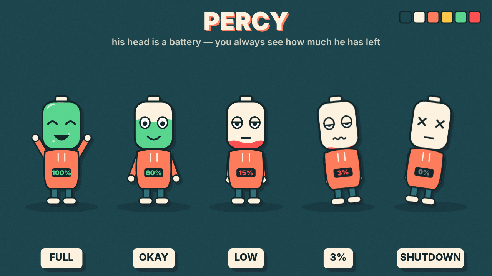

# Концепции канала: 3 варианта

Основа: анализ каналов Day One Films, A Better Mind, BetterU, Ockeroid (см. `../analysis/channels.md`).
Общее для всех вариантов: ниша саморазвития (дофамин, лень, дисциплина, обучение, сон), тёмный фон + один акцентный цвет,
простой персонаж без детального лица, обложка «1–3 слова капсом + эмоция», хиты 2–4 мин, позже длинные 8–12 мин.
Наше отличие от референсов: **юмор** (все три канала о саморазвитии серьёзные).

Наброски обложек: `thumb1.png`, `thumb2.png`, `thumb3.png` (схемы композиции, не финальная графика).

## 1. «Парень, у которого всё идёт не так» (комедия-эксперимент)
- **Персонаж:** круглая голова, сонные полуприкрытые глаза, худи, телефон в руке. Ленивый, но оптимист.
- **Формат:** герой пробует популярный совет (5 AM Club, холодный душ, дофаминовый детокс) и смешно проваливается,
  в конце — что реально работает по науке.
- **Формула заголовка:** «I Tried [X] for 30 Days (It Went Horribly)» / «(Do Not Try This)».
- **Цвет:** жёлто-оранжевый `#FFB800` на `#141414`.
- **Плюсы:** быстро понятно, легко писать сценарии. **Минусы:** «I tried X» — популярный формат, персонажу нужен сильный характер.

## 2. «Офис в голове» (рекомендуется)
- **Персонажи:** мозг — это офис с маленькими сотрудниками:
  - **Менеджер** (префронтальная кора) — уставший, в галстуке, пытается всех организовать;
  - **Дофамин** — тусовщик в колпаке, хочет «ещё одно видео»;
  - **Охранник** (миндалина) — паникёр, жмёт тревожную кнопку из-за письма от начальника;
  - снаружи — **хозяин головы**, обычный парень, который страдает от решений офиса.
- **Формат:** каждая проблема (прокрастинация, бессонница, зависимость от телефона) показана как рабочая комедия внутри головы,
  с реальной наукой. Хорошо масштабируется и в короткие хиты, и в длинные объяснения.
- **Формула заголовка:** «What Your Brain Does When You [X]» / «Why Your Brain [X] (Explained)».
- **Цвет:** розовый `#FF4FA3` + синий `#4A7CFF` на `#12131C`.
- **Плюсы:** уникально среди референсов, постоянный каст (как сериал), бесконечные темы, мерч.
  **Минусы:** нужно больше рисовать; дизайн персонажей делать своим, не копировать «Головоломку» (Inside Out).

## 3. «Сериал на 365 дней» (эмоции + сериальность)
- **Персонаж:** один герой, история идёт по эпизодам от «DAY 1» до «DAY 365» — зритель следит за его изменением.
- **Формат:** короткие фильмы в духе Day One, но с продолжением и лёгким юмором; каждый эпизод — одна привычка или кризис.
- **Формула заголовка:** «[СЛОВО]. | Episode N».
- **Цвет:** зелёный `#3DDC84` (прогресс) на `#0E0E0E`.
- **Плюсы:** запойный просмотр, привязанность к герою. **Минусы:** ближе всего к Day One; новым зрителям сложно войти с середины.

## Рекомендация
Вариант 2 как основа, с элементами 1 (хозяин головы пробует советы и проваливается) и 3 (счётчик дней в экспериментах).

---

# Выбранное направление: персонаж PERCY и свой стиль

**Отличительная черта:** голова Перси — это батарейка с «жидким зарядом» внутри. Зритель всегда видит, сколько у него сил:
зелёный → жёлтый → красный, процент написан на худи. 0% — «выключение» (глаза-крестики, падает).
Заряд отнимают телефон, стресс и прокрастинация; добавляют сон, солнце, спорт и т. д. Это превращает любую тему о
дофамине, энергии и фокусе в наглядную картинку и даёт сквозной гэг для каждого ролика.

**Фирменные элементы:**
- звук: двойной писк «низкий заряд»;
- фраза: «I'm at 3%»;
- формула названий: «Why You're Always at 3%», «What Drains Your Battery», «I Tried X — Here's My Battery».

**Свой стиль (не как у референсов):**
- глубокий бирюзовый фон `#17414A` (не чёрный, как у Day One/BetterU, и не белый, как у A Better Mind);
- обводка тёмно-бирюзовая `#0B2227`, под всеми объектами жёсткая смещённая тень (эффект ризографии), лёгкое зерно;
- палитра: кремовый `#FFF4E0`, коралловый `#FF7A59` (худи), горчичный `#FFC845`; заряд — зелёный `#57D68D` / красный `#FF4D4D`;
- заголовки — Inter Black кремовым с коралловой тенью; подписи — в кремовых плашках.

Пилот: `../pilots/out/v4_percy.mp4` (код сцены — `../pilots/v4_percy.js`, стиль и персонаж — `../pilots/style.js`).
